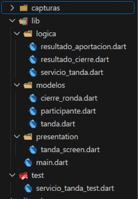
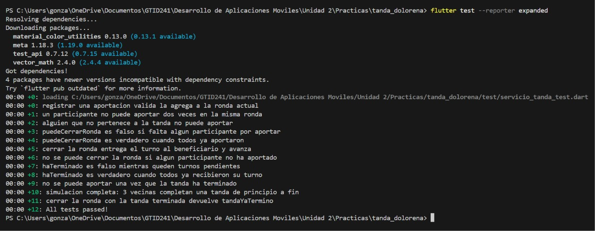
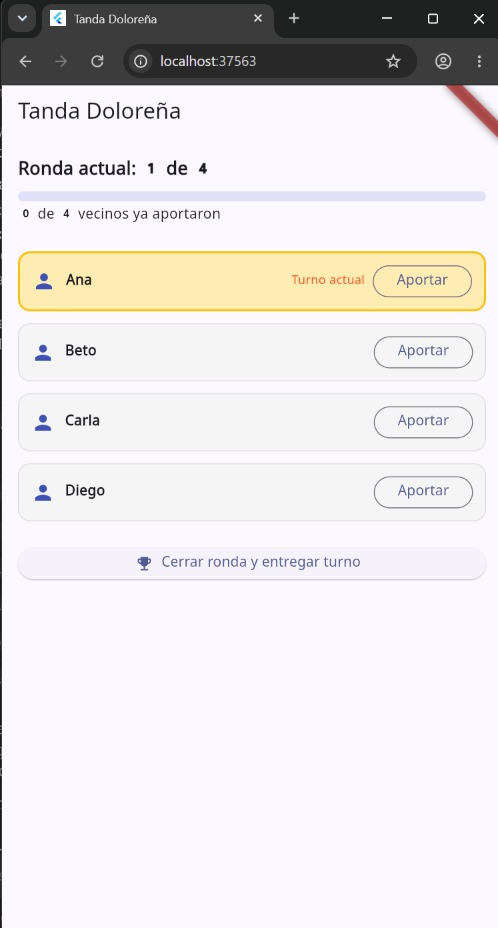
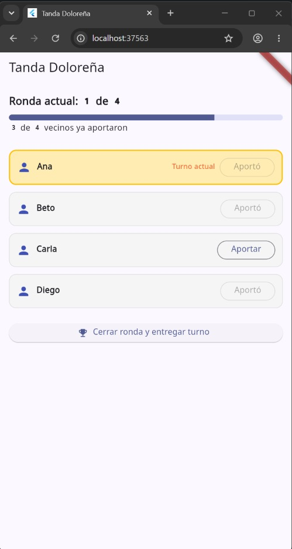
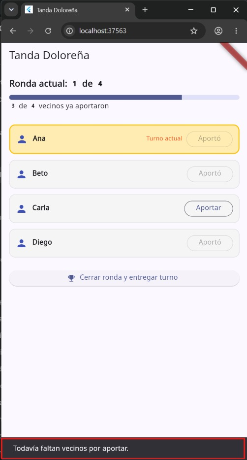
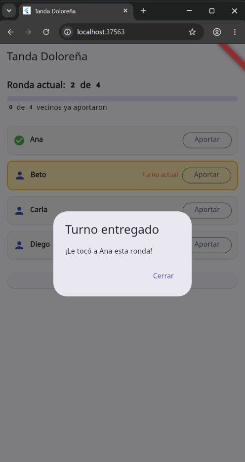
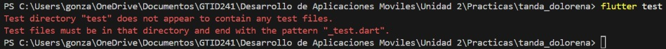
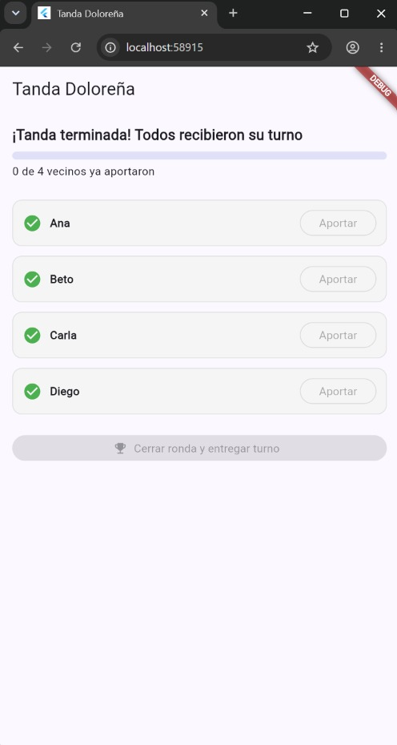

# Tanda Doloreña · Flutter con TDD

**Materia:** Desarrollo Móvil Integral
**Universidad:** UTNG, Dolores Hidalgo
**Alumno:** González López Yael Isaac
**Fecha:** [30 de octubre de 2026]

## Descripción

Sistema de ahorro rotativo (tanda) para un grupo de vecinos. Registra quién aportó en la ronda, solo deja cerrarla cuando todos aportaron, entrega el turno según el orden acordado y termina cuando todos ya recibieron el suyo. Toda la lógica está en Dart puro y se desarrolló con TDD (rojo, verde, refactor). La pantalla animada va al final, encima de reglas ya probadas.

## Estructura del proyecto

### Todas las pruebas en verde

### Pantalla inicial

### Aportaciones a medias

### Cierre sin que todos aporten

### Turno entregado

## Ciclo TDD (opcional)

