# Tanda Doloreña con TDD · Flutter

**Materia:** Desarrollo Móvil Integral
**Universidad:** UTNG, Dolores Hidalgo
**Profesor:** Anastacio Rodríguez García
**Alumno:** González López Yael Isaac
**Fecha:** 18 - noviembre - 2026

## Descripción

App de tanda (ahorro rotativo vecinal) para un grupo de vecinos de Dolores Hidalgo. Registra quién ya aportó en la ronda actual, solo deja cerrar la ronda cuando todos aportaron, entrega el turno según el orden acordado y avanza al siguiente. Cuando todos ya recibieron su turno, la tanda termina y no acepta más aportaciones. Toda la lógica está en Dart puro y se desarrolló con TDD (prueba en rojo, código en verde, refactor); la interfaz animada es la última capa.

## Estructura del proyecto

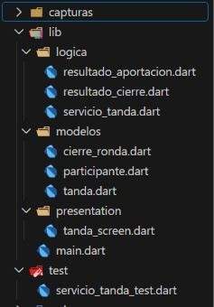

## Pruebas de casos (éxito y fallo) · `test/servicio_tanda_test.dart`

### Prueba 1: registrar una aportacion valida la agrega a la ronda actual

#### Éxito
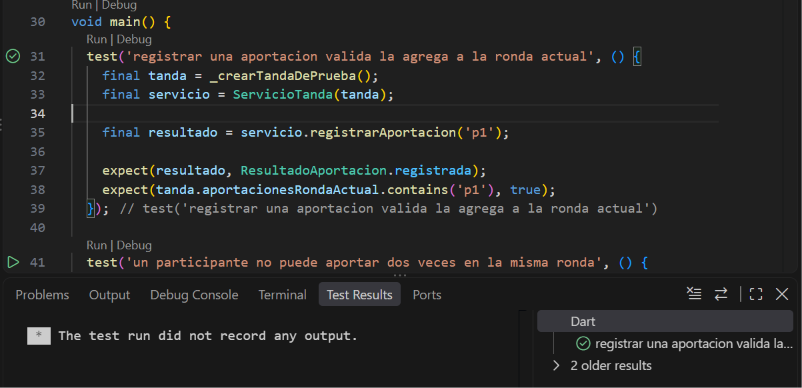

#### Fallo
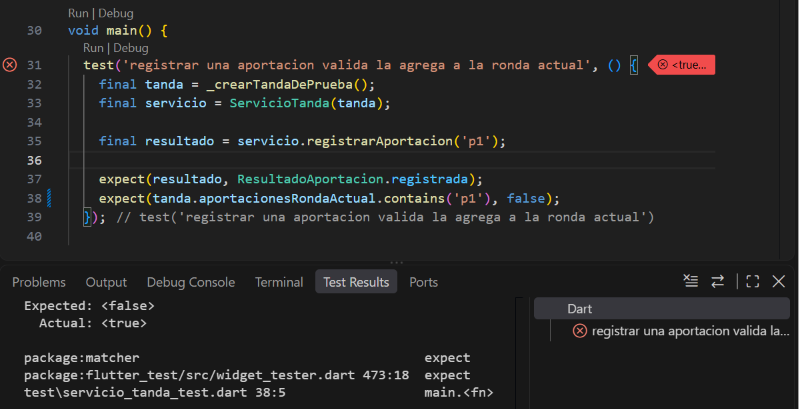

### Prueba 2: un participante no puede aportar dos veces en la misma ronda

#### Éxito
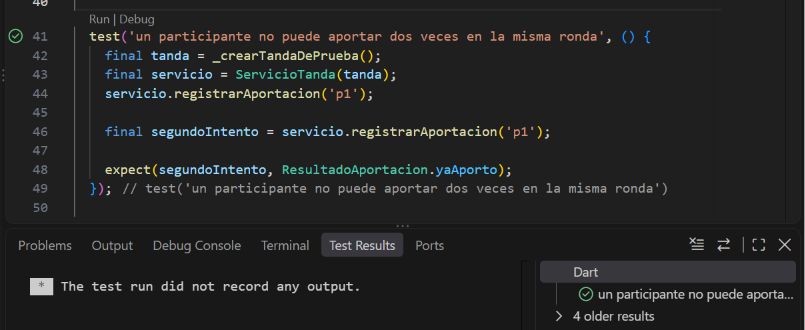

#### Fallo
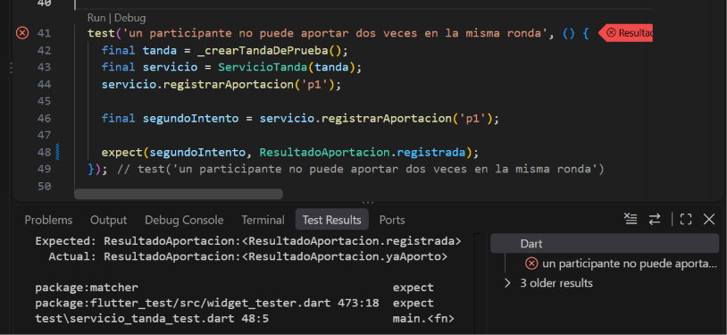

### Prueba 3: alguien que no pertenece a la tanda no puede aportar

#### Éxito
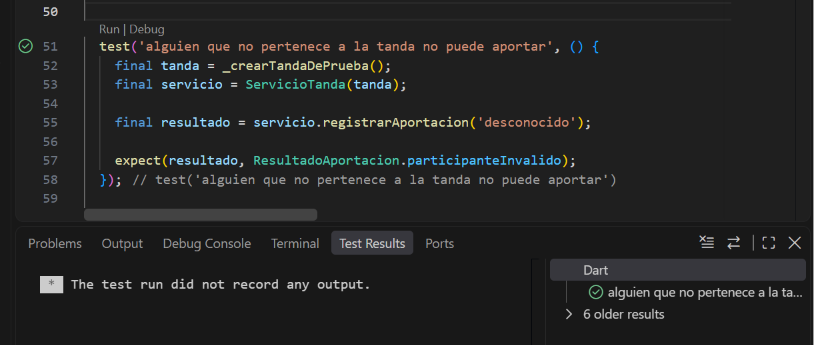

#### Fallo
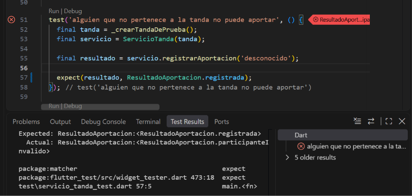

### Prueba 4: puedeCerrarRonda es falso si falta algun participante por aportar

#### Éxito
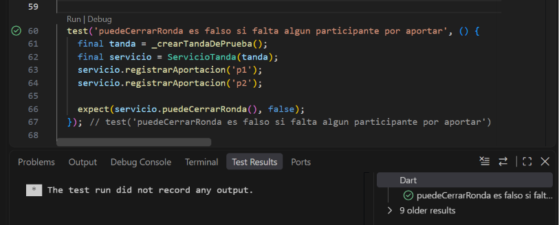

#### Fallo
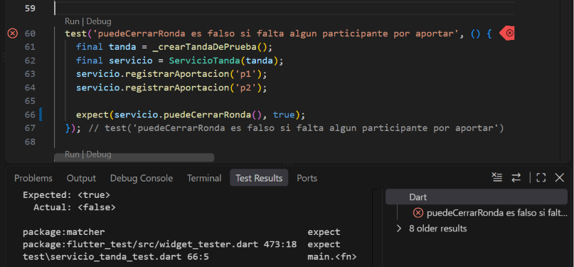

### Prueba 5: puedeCerrarRonda es verdadero cuando todos ya aportaron

#### Éxito
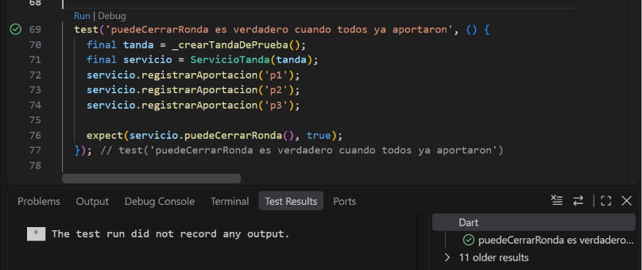

#### Fallo
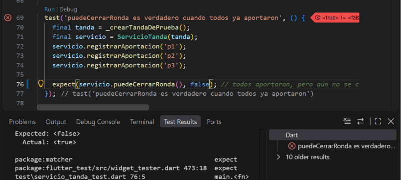

### Prueba 6: cerrar la ronda entrega el turno al beneficiario y avanza

#### Éxito
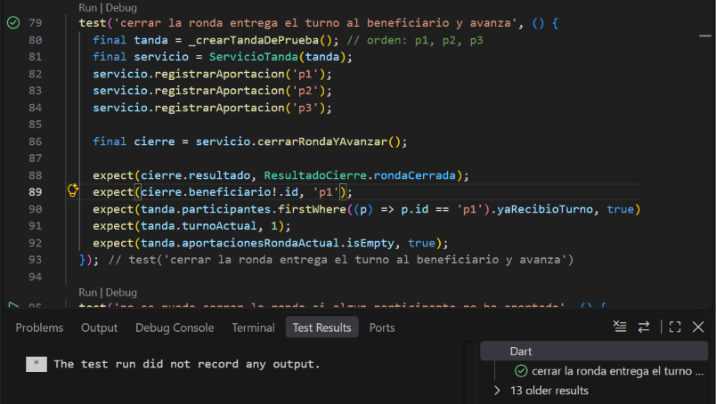

#### Fallo
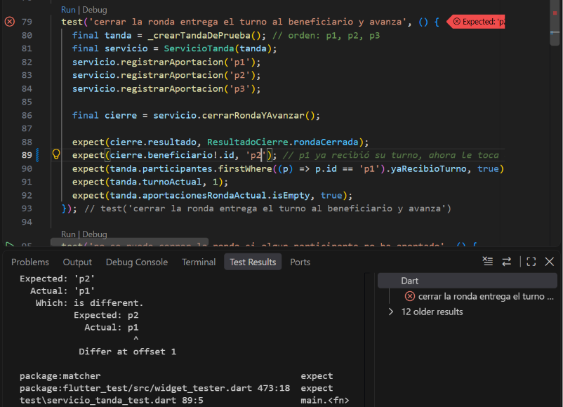

### Prueba 7: no se puede cerrar la ronda si algun participante no ha aportado

#### Éxito
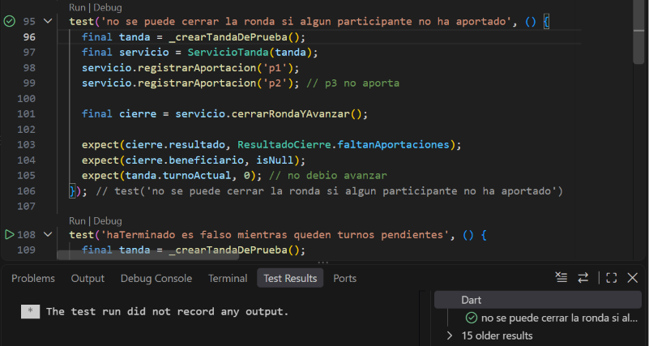

#### Fallo
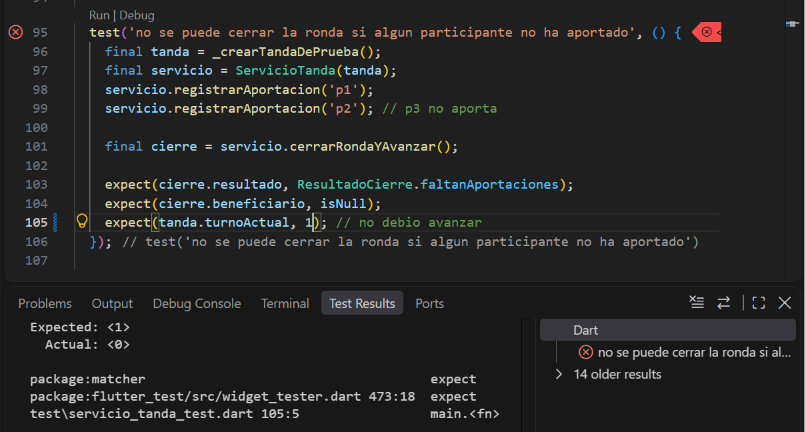

### Prueba 8: haTerminado es falso mientras queden turnos pendientes

#### Éxito
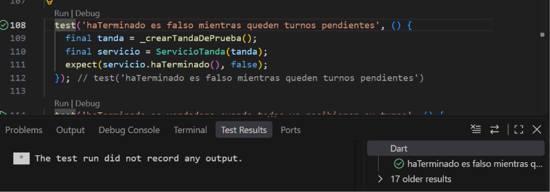

#### Fallo
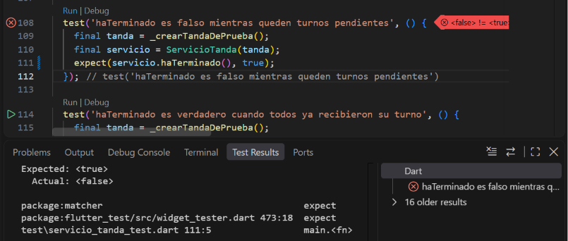

### Prueba 9: haTerminado es verdadero cuando todos ya recibieron su turno

#### Éxito
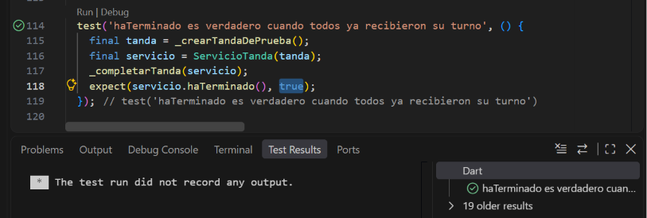

#### Fallo
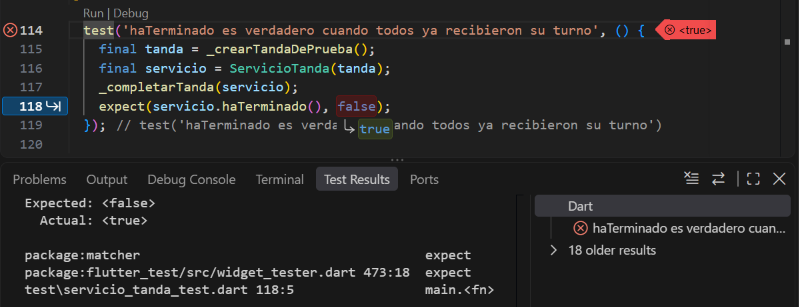

### Prueba 10: no se puede aportar una vez que la tanda ha terminado

#### Éxito
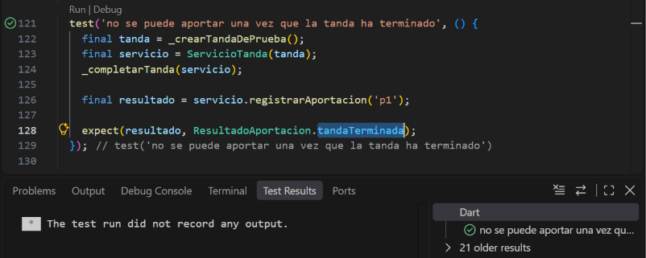

#### Fallo
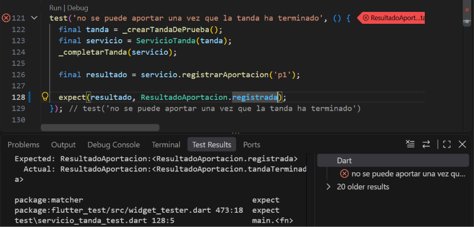

### Prueba 11: simulacion completa: 3 vecinas completan una tanda de principio a fin

#### Éxito
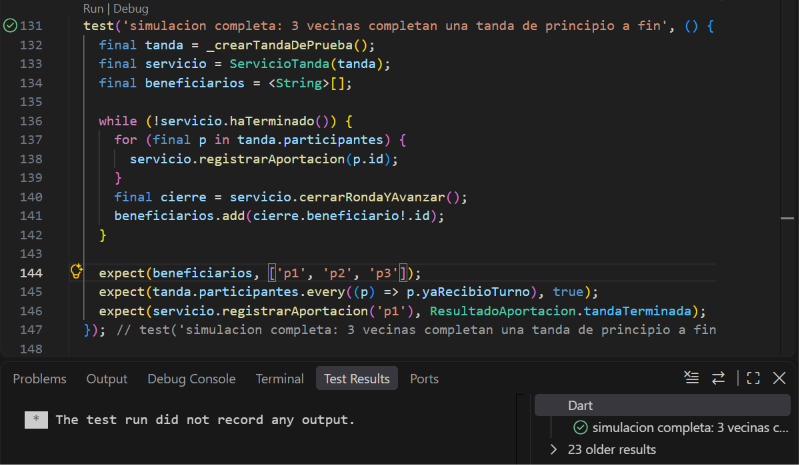

#### Fallo
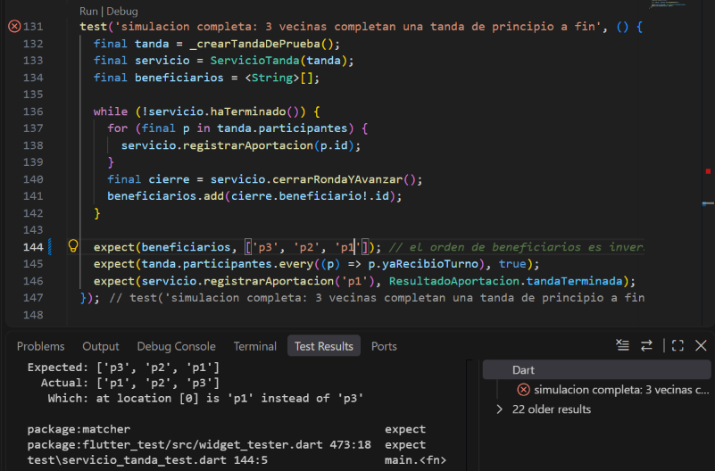

## Todas las pruebas juntas

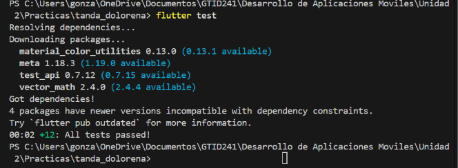

## Evidencia de la aplicación

### Pantalla inicial
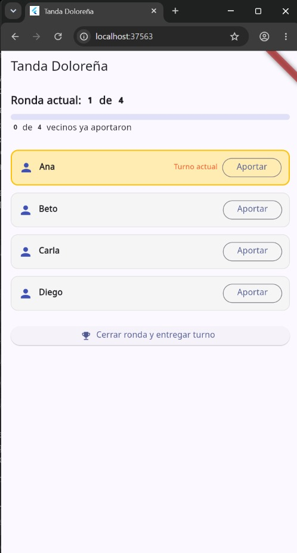

### Todos aportaron
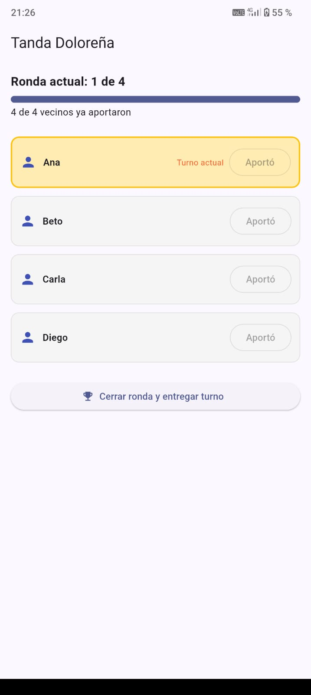

### Cierre de ronda y entrega del turno
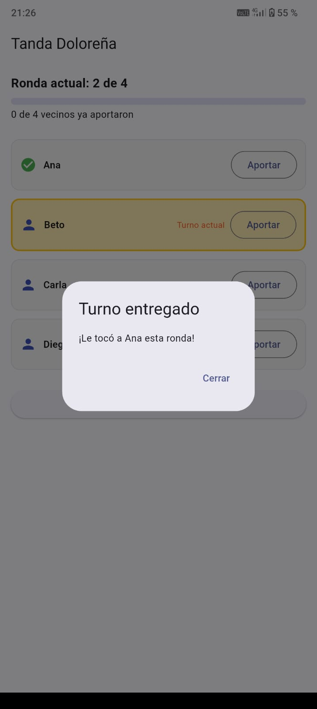

### Tanda terminada
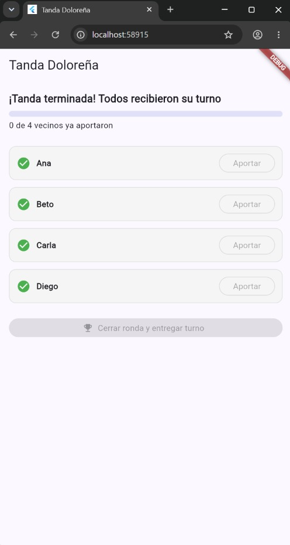